# Poly Haven: Nature models

**28 assets from [Poly Haven](https://polyhaven.com), dedicated to the public domain under [CC0](https://polyhaven.com/license).** Use them in any game, free or paid, and change them however you like; no credit is needed.

3D models as glTF at 1K and 2K texture resolution, each folder self-contained (`.gltf`, `.bin`, `textures/`). 1.4 GB in all.

This is a copy kept by [zuujis-cc0](https://github.com/zuujis-cc0) so game makers can take single files from GitHub. It is not made by or affiliated with Poly Haven: the originals, often in more formats and higher resolutions, are on [polyhaven.com](https://polyhaven.com). If they help you, consider [supporting Poly Haven](https://www.patreon.com/polyhaven/overview).

Every file is listed in [MANIFEST.tsv](MANIFEST.tsv) with its size and SHA-256. More free assets: [the Zuujis collection](https://github.com/zuujis-cc0/free-game-assets#readme).

| | | | |
| :-: | :-: | :-: | :-: |
| <a href="jacaranda_tree">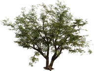</a> <b><a href="jacaranda_tree">Jacaranda Tree</a></b> by Rico Cilliers, Rob Tuytel · <a href="https://polyhaven.com/a/jacaranda_tree">source</a> | <a href="leipoldtia_schultzei">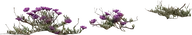</a> <b><a href="leipoldtia_schultzei">Leipoldtia Schultzei</a></b> by Jenelle van Heerden · <a href="https://polyhaven.com/a/leipoldtia_schultzei">source</a> | <a href="moon_rock_01">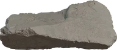</a> <b><a href="moon_rock_01">Moon Rock 01</a></b> by Dario Barresi, Greg Zaal, Jenelle van Heerden, Rico Cilliers · <a href="https://polyhaven.com/a/moon_rock_01">source</a> | <a href="moon_rock_02">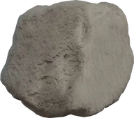</a> <b><a href="moon_rock_02">Moon Rock 02</a></b> by Greg Zaal, Jenelle van Heerden, Rico Cilliers · <a href="https://polyhaven.com/a/moon_rock_02">source</a> |
| <a href="moon_rock_03">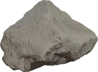</a> <b><a href="moon_rock_03">Moon Rock 03</a></b> by Greg Zaal, Jenelle van Heerden, Rico Cilliers · <a href="https://polyhaven.com/a/moon_rock_03">source</a> | <a href="moon_rock_04">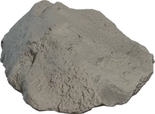</a> <b><a href="moon_rock_04">Moon Rock 04</a></b> by Greg Zaal, Jenelle van Heerden, Rico Cilliers · <a href="https://polyhaven.com/a/moon_rock_04">source</a> | <a href="moon_rock_05">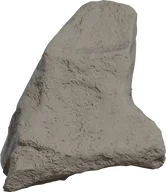</a> <b><a href="moon_rock_05">Moon Rock 05</a></b> by Greg Zaal, Jenelle van Heerden, Rico Cilliers · <a href="https://polyhaven.com/a/moon_rock_05">source</a> | <a href="moon_rock_06">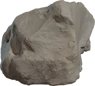</a> <b><a href="moon_rock_06">Moon Rock 06</a></b> by Greg Zaal, Jenelle van Heerden, Rico Cilliers · <a href="https://polyhaven.com/a/moon_rock_06">source</a> |
| <a href="moon_rock_07">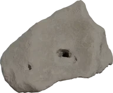</a> <b><a href="moon_rock_07">Moon Rock 07</a></b> by Greg Zaal, Jenelle van Heerden, Rico Cilliers · <a href="https://polyhaven.com/a/moon_rock_07">source</a> | <a href="moss_01">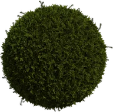</a> <b><a href="moss_01">Moss 01</a></b> by Rob Tuytel · <a href="https://polyhaven.com/a/moss_01">source</a> | <a href="mountainside">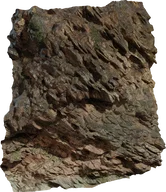</a> <b><a href="mountainside">Mountainside</a></b> by Dario Barresi, Rico Cilliers · <a href="https://polyhaven.com/a/mountainside">source</a> | <a href="namaqualand_boulder_02">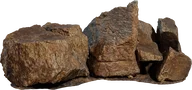</a> <b><a href="namaqualand_boulder_02">Namaqualand Boulder 02</a></b> by Greg Zaal, Rico Cilliers · <a href="https://polyhaven.com/a/namaqualand_boulder_02">source</a> |
| <a href="namaqualand_boulder_03">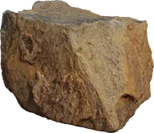</a> <b><a href="namaqualand_boulder_03">Namaqualand Boulder 03</a></b> by Dario Barresi, Jenelle van Heerden · <a href="https://polyhaven.com/a/namaqualand_boulder_03">source</a> | <a href="namaqualand_boulder_04">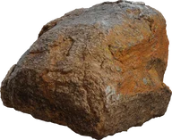</a> <b><a href="namaqualand_boulder_04">Namaqualand Boulder 04</a></b> by Jenelle van Heerden · <a href="https://polyhaven.com/a/namaqualand_boulder_04">source</a> | <a href="namaqualand_boulder_05">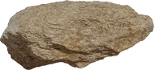</a> <b><a href="namaqualand_boulder_05">Namaqualand Boulder 05</a></b> by Dario Barresi, Jenelle van Heerden · <a href="https://polyhaven.com/a/namaqualand_boulder_05">source</a> | <a href="namaqualand_boulder_06">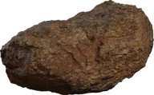</a> <b><a href="namaqualand_boulder_06">Namaqualand Boulder 06</a></b> by Greg Zaal, Jenelle van Heerden · <a href="https://polyhaven.com/a/namaqualand_boulder_06">source</a> |
| <a href="namaqualand_boulders_01">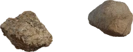</a> <b><a href="namaqualand_boulders_01">Namaqualand Boulders 01</a></b> by Greg Zaal, Jenelle van Heerden · <a href="https://polyhaven.com/a/namaqualand_boulders_01">source</a> | <a href="namaqualand_cliff_01">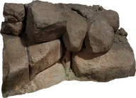</a> <b><a href="namaqualand_cliff_01">Namaqualand Cliff 01</a></b> by Jenelle van Heerden, Rico Cilliers · <a href="https://polyhaven.com/a/namaqualand_cliff_01">source</a> | <a href="namaqualand_cliff_02">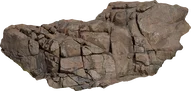</a> <b><a href="namaqualand_cliff_02">Namaqualand Cliff 02</a></b> by Dario Barresi, Rico Cilliers · <a href="https://polyhaven.com/a/namaqualand_cliff_02">source</a> | <a href="namaqualand_rocks_01">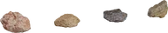</a> <b><a href="namaqualand_rocks_01">Namaqualand Rocks 01</a></b> by Greg Zaal, Jenelle van Heerden · <a href="https://polyhaven.com/a/namaqualand_rocks_01">source</a> |
| <a href="namaqualand_stones_01">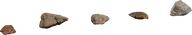</a> <b><a href="namaqualand_stones_01">Namaqualand Stones 01</a></b> by Greg Zaal, Jenelle van Heerden · <a href="https://polyhaven.com/a/namaqualand_stones_01">source</a> | <a href="nettle_plant">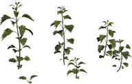</a> <b><a href="nettle_plant">Nettle Plant</a></b> by Rico Cilliers, Rob Tuytel · <a href="https://polyhaven.com/a/nettle_plant">source</a> | <a href="othonna_cerarioides">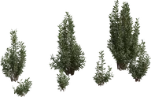</a> <b><a href="othonna_cerarioides">Othonna Cerarioides</a></b> by James Ray Cock, Jenelle van Heerden · <a href="https://polyhaven.com/a/othonna_cerarioides">source</a> | <a href="pachira_aquatica_01">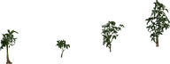</a> <b><a href="pachira_aquatica_01">Pachira Aquatica 01</a></b> by Rico Cilliers, Rob Tuytel · <a href="https://polyhaven.com/a/pachira_aquatica_01">source</a> |
| <a href="periwinkle_plant">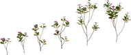</a> <b><a href="periwinkle_plant">Periwinkle Plant</a></b> by Amal Kumar · <a href="https://polyhaven.com/a/periwinkle_plant">source</a> | <a href="pine_roots">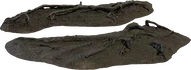</a> <b><a href="pine_roots">Pine Roots</a></b> by Rob Tuytel · <a href="https://polyhaven.com/a/pine_roots">source</a> | <a href="pine_sapling_medium">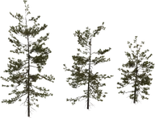</a> <b><a href="pine_sapling_medium">Pine Sapling Medium</a></b> by Rico Cilliers, Rob Tuytel · <a href="https://polyhaven.com/a/pine_sapling_medium">source</a> | <a href="pine_sapling_small">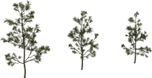</a> <b><a href="pine_sapling_small">Pine Sapling Small</a></b> by Rico Cilliers, Rob Tuytel · <a href="https://polyhaven.com/a/pine_sapling_small">source</a> |

---

Kept up to date by this repository's own [update workflow](.github/workflows/update.yml), with code and plan from [cc0-mirror](https://github.com/zuujis-cc0/cc0-mirror). Something wrong? [Open an issue there](https://github.com/zuujis-cc0/cc0-mirror/issues/new) or use the [private report form](https://games.zuujis.com/report).
